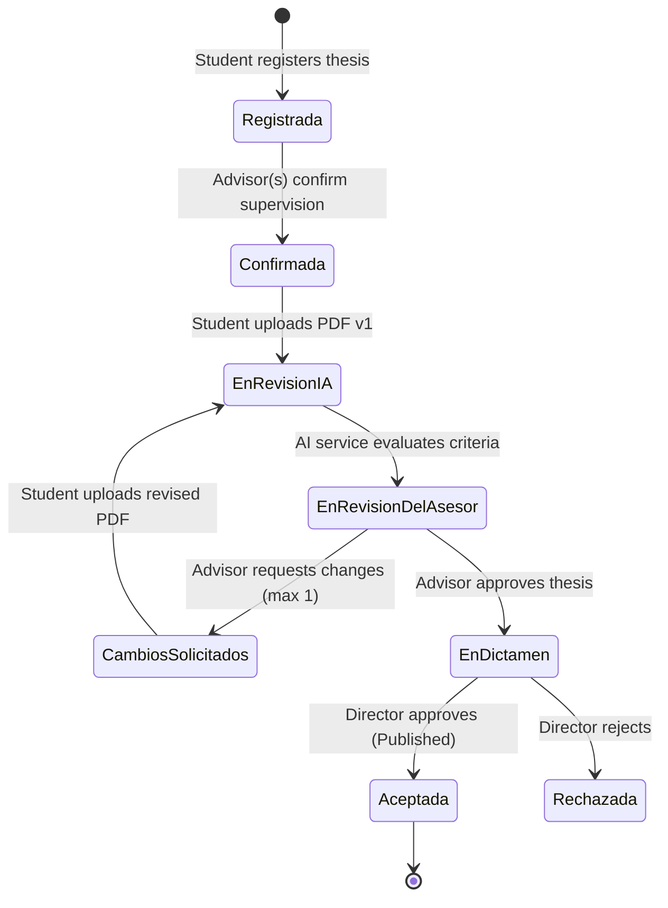

# SIRET — Sistema Integral de Repositorio y Evaluación de Tesis

**Full-Stack Thesis Lifecycle, AI Auditing & Academic Repository Platform**  
Built with **.NET 8 (Clean Architecture)**, **Angular 21**, **Tailwind CSS**, **SQL Server**, and **Python (AI Evaluation Service)**.

> 🇪🇸 **Resumen en Español:** Plataforma integral para gestionar, auditar con Inteligencia Artificial y publicar el ciclo de vida completo de tesis de posgrado (desde el registro del alumno y validación de asesores hasta el dictamen final y repositorio público), construida con **.NET 8 (Clean Architecture)**, **Angular 21**, **SQL Server** y un microservicio de auditoría en **Python**.

---

## Architecture & Tech Stack

### Backend (`backend/` — .NET 8.0 / C#)
Four-layer **Clean Architecture** + automated integration test suite:
- **`Tesis.Domain`**: Core entities (`Tesis`, `Alumno`, `Profesor`, `Posgrado`, `TesisVersion`, `HistorialEstadoTesis`, `RevisionIA`, `RevisionAsesor`, `Dictamen`, `Favorito`, `Articulo`), enums, and domain rules.
- **`Tesis.Application`**: Use cases, command orchestration, repository abstractions, and DTOs.
- **`Tesis.Infrastructure`**: Entity Framework Core (SQL Server), Fluent API configurations, PDF reference extraction, SMTP email service, and AI review client.
- **`Tesis.Api`**: REST controllers, JWT Bearer authentication, role-based authorization (RBAC), Swagger/OpenAPI, and centralized exception middleware.
- **`Tesis.Api.Tests`**: **58 integration & HTTP contract tests** using **xUnit** and `WebApplicationFactory`.

### Frontend (`frontend/` — Angular 21 + Tailwind CSS)
- Standalone components, Angular signals, reactive forms, JWT interceptor, and role/auth route guards.
- Responsive UI with embedded PDF viewer modal and role-specific dashboards.

### AI Auditing Microservice (`Tesis-IA/` — Python)
- Evaluates uploaded thesis PDFs across structured academic criteria and returns an automated review score and feedback to the backend.

---

## Thesis Lifecycle State Machine



---

## Role-Based Access Control (RBAC)

| Role | Key Capabilities |
| :--- | :--- |
| **Student (`Alumno`)** | Register thesis, nominate advisor/co-advisor, upload PDF versions, attach articles, submit corrections. |
| **Advisor (`Docente`)** | Accept/reject supervision, trigger AI review, request changes, or approve for final evaluation. |
| **Program Director (`Director`)** | Review theses in `EnDictamen`, inspect AI & advisor feedback, issue final verdict (`Aceptada` / `Rechazada`). |
| **Admin (`Administrador`)** | Manage users, validate faculty accounts, configure postgraduate programs, and view KPIs. |
| **Guest (`Invitado`)** | Search and filter the public repository, read published theses, and manage favorites. |

---

## Quick Start

### 1. Backend (.NET 8)
Update `ConnectionStrings:TesisDb` and `Correo` placeholders in `backend/src/Tesis.Api/appsettings.json` (or use `dotnet user-secrets`), then run:

```bash
cd backend
dotnet restore
dotnet test
dotnet run --project src/Tesis.Api
```

### 2. Frontend (Angular 21)
```bash
cd frontend
npm install
npm start
```

### 3. AI Service (Python)
```bash
cd Tesis-IA
pip install -r requirements.txt
python main.py
```
